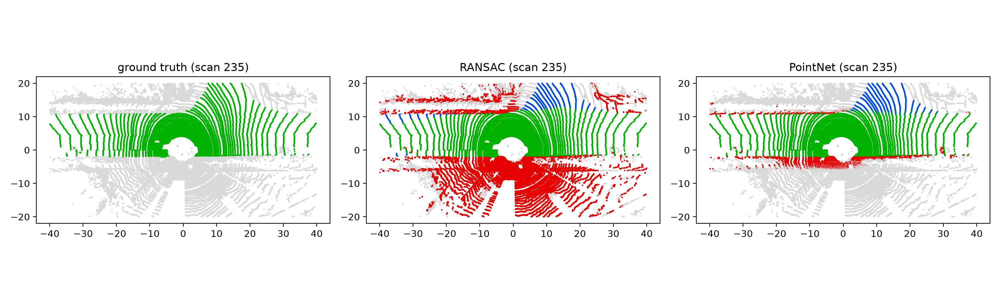
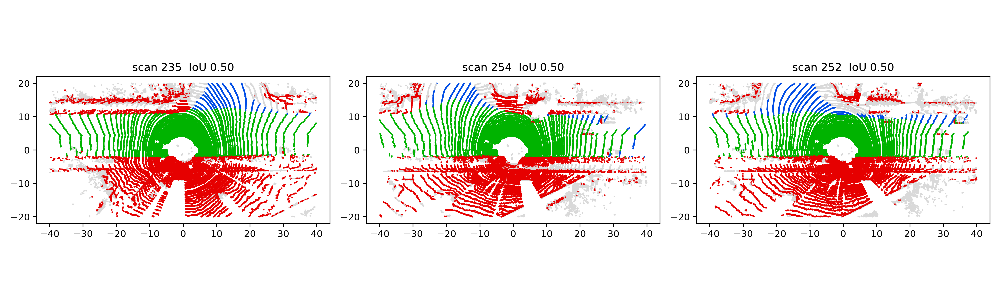

# LiDAR Road Segmentation on SemanticKITTI

Road vs. non-road segmentation of LiDAR point clouds. I compare a classical
**RANSAC ground-plane baseline** with a small **PointNet** (PyTorch), using
IoU and F1, and analyze where each method fails.

> Status: first version. Results come from a single sequence (see Limitations).

## Task
For every point of a LiDAR scan, decide: road (including parking) or not road.
Evaluation is limited to the area around the car (40 m forward/backward, 20 m left/right).

## Data
[SemanticKITTI](https://semantic-kitti.org/) sequence 04: 271 scans (Velodyne HDL-64E).
The full dataset is about 80 GB, so `get_seq04.py` extracts only sequence 04 from the
KITTI odometry zip. Labels come from the SemanticKITTI label download.
The data is not part of this repo (license). You need your own KITTI download link.

## Methods
1. **RANSAC baseline:** fit one ground plane to points below z = -1 m and predict
   everything within 20 cm of the plane as road.
2. **PointNet:** a shared per-point network, max-pooling for a global scene feature,
   and a per-point classification head. Trained on 4096 random points per scan.
3. **Split:** chronological. Train on scans 0-185, test on scans 200-270
   (gap of 14 scans so neighbouring, nearly identical scans do not leak into the test set).

## Results (test scans 200-270, same points for both methods)

| Method   | Mean IoU | Mean F1 |
|----------|----------|---------|
| RANSAC   | 0.538    | 0.699   |
| PointNet | 0.881    | 0.935   |

Single run, one seed.



## Failure analysis
**RANSAC** (over all 271 scans, mean IoU about 0.60):
- About 92% of its false alarms are terrain (~35%), sidewalk (~30%) and vegetation (~27%).
  A flat plane cannot tell where the road ends.
- Missed road points are far from the car (median about 19 m, compared with about 7 m for
  correctly found road points).



**PointNet:** most of its remaining false alarms are terrain (~62%) and sidewalk (~29%).

## Limitations
- One short, mostly straight sequence. The result may not transfer to other scenes.
- The model sees coordinates relative to the car and may partly learn "road is roughly here".
- Single training run, no repeated seeds.
- RANSAC parameters were not tuned.

Planned: test on other sequences, repeat with several seeds, check position dependence,
analyze PointNet errors by distance.

## How to run
```bash
pip install -r requirements.txt
python get_seq04.py        # needs your own KITTI link inside the file
python step2_view_scan.py  # look at one scan
python step3_ransac.py     # baseline + scores
python step5_failures.py   # baseline failure analysis
python step6_pointnet.py   # train and test PointNet, compare
```
Labels go to `data/dataset/sequences/04/labels/`.