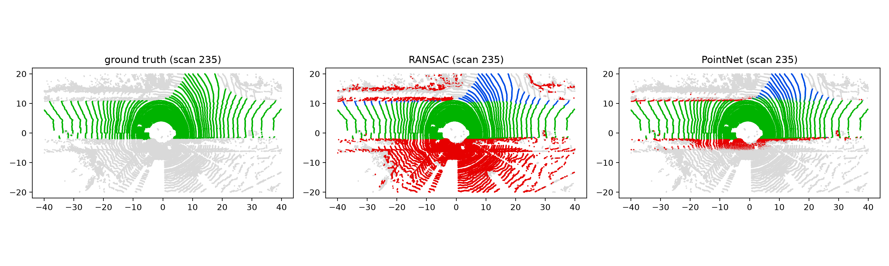

# LiDAR Road Segmentation on SemanticKITTI

Road vs. non-road segmentation of LiDAR point clouds. I compare a classical
**RANSAC ground-plane baseline** with a small **PointNet** (PyTorch), using
IoU and F1, test how well it carries over to another drive, and analyze where each method fails.

> Status: work in progress.

## Task
For every point of a LiDAR scan, decide: road (including parking) or not road.
Evaluation is limited to the area around the car (40 m forward/backward, 20 m left/right).

## Data
[SemanticKITTI](https://semantic-kitti.org/) (Velodyne HDL-64E). I use sequences 04, 00 and 07.
The full velodyne download is about 80 GB, so `get_sequence.py` extracts only the scans I need
from the KITTI odometry zip. Labels come from the SemanticKITTI label download.
The data is not part of this repo (license). You need your own KITTI download link,
put on one line into a file named `kitti_url.txt`.

## Methods
1. **RANSAC baseline:** fit one ground plane to points below z = -1 m and predict
   everything within 20 cm of the plane as road.
2. **PointNet:** a shared per-point network, max-pooling for a global scene feature,
   and a per-point classification head. Trained on 4096 random points per scan
   (30 epochs, Adam, learning rate 1e-3, batch size 16, random left/right mirroring).
3. **Two training setups:**
   - 186 scans of sequence 04 (scans 0-185)
   - 186 scans of sequence 04 + 186 scans of sequence 00
4. **Testing:** sequence 04, scans 200-270 (later in the same drive, with a gap of 14 scans
   after the training scans), and sequence 07, first 300 scans (a different drive, never used in training).
   Both methods are scored on exactly the same points.

## Results (mean ± std over 3 training seeds, IoU / F1)

| PointNet trained on | Seq 04, scans 200-270 | Seq 07, first 300 scans (other drive) |
|---|---|---|
| 186 scans of seq 04 | 0.874 ± 0.007 / 0.931 ± 0.004 | 0.599 ± 0.055 / 0.741 ± 0.040 |
| 186 scans of seq 04 + 186 of seq 00 | 0.798 ± 0.065 / 0.885 ± 0.041 | 0.718 ± 0.012 / 0.831 ± 0.006 |
| RANSAC baseline (no training) | 0.538 / 0.699 | 0.464 / 0.628 |

- PointNet beats RANSAC in every run on both test sets.
- Trained on one drive, it scores well on that drive (0.87) but much lower on another (0.60).
- Adding a second drive's scans raised the score on the other drive (0.60 to 0.72, with less
  variation between seeds), at the cost of a lower and less stable score on the first drive.

Experiments that gave no clear effect (single seed, sequence 07 IoU):
- Random shifts of each training scan up to 4 m: 0.577, against 0.609 for the same seed without shifts.
- 93 scans from each of the two drives (the same number of training scans as the one-drive model): 0.515.



## Failure analysis
**RANSAC** (sequence 04, all 271 scans, mean IoU about 0.60): about 90% of its false alarms
are terrain, sidewalk and vegetation next to the road, because a flat plane cannot tell where
the road ends. Missed road is mostly far from the car (median about 19 m, against about 7 m
for the road it found).

**PointNet trained on seq 04 only (seed 0), tested on seq 07:** its false alarms are mostly
sidewalk (87%), and it misses about 21% of the road points. Its score at 3-10 m sideways from
the car is very low (about 0.14-0.19 IoU), which fits a model that learned the road layout
of sequence 04. A shift experiment did not confirm or rule out this explanation.


## Limitations
- Only sequences 04, 00 and 07 were used, and only the first 300 scans of 07 for testing.
- Sequence 07 was used repeatedly to choose experiments, so its scores are slightly optimistic.
- The two-drive model also had twice the training scans. The 93 + 93 run suggests extra data matters,
  but data amount and variety are not separated yet.
- I do not know whether any places overlap between the sequences.
- The models see only point coordinates (no intensity, no neighbourhood information).
- RANSAC parameters were not tuned.

Planned: a control run with only sequence 00, intensity as an extra input,
a test on a sequence not used so far.

## How to run
```bash
pip install -r requirements.txt
python get_seq04.py            # sequence 04 (needs kitti_url.txt, see Data)
python get_sequence.py 07 300  # any sequence: name and number of scans
python step2_view_scan.py      # look at one scan
python step3_ransac.py         # baseline + scores
python step5_failures.py       # baseline failure analysis
python step6_pointnet.py 0     # train and test PointNet (argument = seed)
python step7_transfer.py 0 07  # test a trained model on sequence 07
python step8_error_analysis.py 0 07   # errors by distance, sideways position and class
python step9_train_multi.py 0 186     # train on sequences 04 + 00, test on 04 and 07
```
Labels go to `data/dataset/sequences/<sequence>/labels/`.